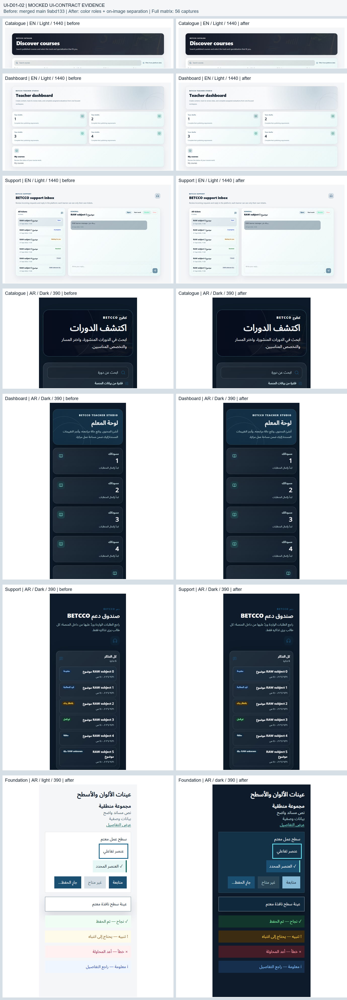

# UI-D01-02 — Color, neutral and surface foundation

Base: `9abd13336f6c606f6dceaa52c566e43ca506e487` (merged #191). Contract: UI-D00-01-BETCCO-Design-Contract.md sections 3, 6, 8, 16–17 and UI-D00-01-Owner-Decisions.md; DC01–DC16 approved without modification on 17 October 2026. This implements the approved DC02/DC05/DC07 foundation only. Typography delivery, icons, navigation, layout, progress and business logic are unchanged.

## Architecture and compatibility

The existing owner remains `brand-tokens.css` → `globals.css` `--ui-*` roles → Tailwind `@theme inline` aliases. 118 additive custom properties: 32 approved primitive steps, 43 semantic roles and 43 Tailwind aliases. 85 of the added properties alias an existing/approved owner; zero tokens removed. Six identity anchors and font fallback declarations are unchanged. See the full token inventory in the local evidence package.

| Family                    | Role contract                                                                                                                                                                                      |
| ------------------------- | -------------------------------------------------------------------------------------------------------------------------------------------------------------------------------------------------- |
| Canvas / section          | `surface-canvas` aliases existing page; `surface-section` is transparent                                                                                                                           |
| Working panel             | `surface-panel`: white in Light, #133147 in Dark; no routine shadow/glass                                                                                                                          |
| Interactive item          | Transparent `surface-row`; explicit row-hover/pressed plus selection surface/text/marker; selected styling must continue to outrank ordinary hover                                                 |
| Overlay                   | Existing opaque `surface-overlay` + existing overlay shadow; new independent scrim role                                                                                                            |
| Text / icons              | Existing primary/secondary/muted; Light text-link becomes approved teal 700 #086459; independent invariant on-image; default/action icon aliases                                                   |
| Required boundary / focus | New control/interactive boundary and selected marker; focus-ring aliases existing focus. Legacy default/subtle borders remain compatibility/decorative roles                                       |
| States                    | Existing independent success/warning/danger/info foreground/surface pairs retained; expanded foreground/border aliases and neutral fallback added; labels and actual status mappings remain intact |

**Primary action migration:** existing `--ui-action-primary` / `--ui-action-primary-text` remain blue/off-white in both themes. Existing Actions, pending actions and student gradient consumers retain their current appearance. The new `--ui-action-primary-surface` / `--ui-action-primary-foreground` family establishes the approved opt-in target, including surface-hover/pressed: Light blue/off-white; Dark #86BAD6/#0D1B2A. Always adopt this family together in a separately authorized consumer slice. The shorter primary-hover/pressed roles belong to the compatibility blue/off-white family; do not mix the two pairs.

Only the three catalogue hero foreground classes migrate to `text-text-on-image`, which resolves to #F5F6F8 in both themes and never aliases action text. The #191 scrim, dashboard components and Support mapping are unchanged. All eight catalogue before/after captures have identical rendered pixels. The existing T7 projection accepts only the exact renamed catalogue seams; the new mutation case rejects reverting to action text. No broad class/string erasure or historical fixture update.

Legacy `.card`, global backgrounds, surface-content, primary aliases and geometry/motion remain unchanged. New required border consumers follow the existing Action convention of `border-border-interactive!` where the legacy unlayered universal border rule would otherwise win; the specimen verifies the resulting boundary. No global border/reset rewrite is hidden here.

## Validation

- Focused tests: 45/45 across four files.
- Full requested command `pnpm test --maxWorkers=2`: 2365/2365 across 97 files.
- `pnpm format:check`, `pnpm exec eslint . --max-warnings 0`, `pnpm typecheck`, `pnpm build`, `git diff --check`: passed.
- [Core contrast table](ui-d01-02-contrast.md): 140/140 pairs, 70 per theme. Minimum normal-text pair 4.690:1; required boundary/focus minimum 3.059:1. Palette calculations exclude transparent bases and actual image composites.
- 56 Chromium captures: catalogue/dashboard/Support before + after and new foundation after; EN/AR, Light/Dark, 1440×900 and 390×844. Twenty-four before/after data/text pairs matched; no horizontal overflow or browser page errors. App theme was explicit and OS preference opposite; this does not resolve the separately deferred application theme/CSP behavior.
- Sampled rendered minima after: catalogue text/background pixels 8.717:1; dashboard icons/adjacent painted backing 5.175:1; ticket list status pairs 6.607:1. Focus, selected, disabled/pending and overlay boundary were also checked in the new specimen.

**MOCKED UI-CONTRACT EVIDENCE.** These are isolated actual production components with real generated Tailwind CSS and Next Image/default config, fixed synthetic GET responses and the same data before/after. Original image assets are served locally without the Next image optimization server. This is not full Next routing/SSR/CSP, backend authorization, payment, persistence, entitlement or whole-site WCAG proof. The new foundation specimen is not imported by any product route.

## Deferred work and stop

Do not globally adopt new surfaces, rewrite glass cards, activate the target primary pair across current Actions, install fonts, change navigation/icons/progress, or begin UI-D01-03 under this PR. PR #190 dependency/lock changes remain separate; no package, lockfile, CI, translations, backend/schema/API/auth/payment/assessment/Resit/Retake/AI-RAG files changed. Required independent PR review and merge approval remain future gates. Draft only; do not merge, mark Ready or enable auto-merge.
