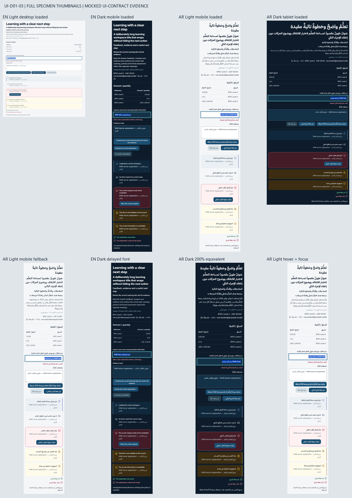

# UI-D01-03 — Validate and adopt bilingual typography

Authoritative roadmap: the completed `UI-DEEP-01-Modernization-Roadmap.md`, exact UI-D01-03 entry. Goal: test Inter + IBM Plex Sans Arabic, approve actual metrics and migrate a bounded set of shared text roles. Dependencies: UI-D01-01/02 and D04/D05, licensed delivery and fallback verification. Complexity Medium; business risk Medium due to text dimensions and delivery cost. DC01–DC16 remain approved and locked; DC03 supplies the exact scale below.

Base: `000cf2e39932cbfaaa2f142d057b6883783a1781`, the merged #192 UI-D01-02 foundation. Preflight found only #190 open, owning `frontend/package.json` and `frontend/pnpm-lock.yaml`. Neither is changed.

## Bounded adoption

The existing brand → `--ui-*` → consumer architecture remains. Five locally served normal font faces and separate opt-in family aliases implement Inter EN and IBM Plex Sans Arabic AR. All existing non-typography semantic and compatibility values in both themes are protected by regression comparison. Six brand anchors, color ramps, action pairs, surfaces, focus, borders and shadows retain their merged values.

The eight named text roles use the locked scale, normal Arabic tracking and weights 400/500/600/700, with synthesis disabled. Existing heading tracking is retained for English. Explicit `lang` runs choose their own family and normal tracking; raw strings and numeric formatting are unchanged. Comparable Latin data uses verified tabular figures; Arabic-Indic data remains proportional and end-aligned.

No production `.ui-type-*` callers existed at baseline. This slice therefore adopts two narrow shared primitives: Action uses the Label role; QueryState uses Label titles, Body descriptions and Label MutationOutcome text. These are class-only changes. An exact seam projection compares the complete remaining TypeScript syntax with the baseline, with negative mutations for disabled/pending/ARIA/error/raw-content behavior. State maps, retry handlers, precedence, native button behavior and caller copy are unchanged.

Global body defaults, `--font-sans`, legacy font aliases and both layout modules remain byte-identical. Catalogue, dashboard and Support code, translation catalogues, dependencies, lockfile, routing, backend, API, assessment, commerce and AI/RAG are untouched. This is bounded shared typography adoption; no feature-page redesign or global replacement of heavy classes occurs.

| Role    | EN size / line          | AR size / line          | Weight                 |
| ------- | ----------------------- | ----------------------- | ---------------------- |
| Display | 56 / 64; mobile 32 / 40 | 48 / 72; mobile 30 / 46 | 700                    |
| Page    | 28 / 36; mobile 24 / 32 | 28 / 42; mobile 24 / 38 | 700                    |
| Section | 20 / 28                 | 20 / 32                 | 600                    |
| Item    | 16 / 24                 | 17 / 28                 | 600                    |
| Body    | 16 / 26                 | 16 / 29                 | 400                    |
| Label   | 14 / 22                 | 15 / 26                 | 500                    |
| Meta    | 12 / 18                 | 13 / 22                 | 400                    |
| Data    | 14 / 22                 | 15 / 26                 | 400; table headers 600 |

Values are CSS px; mobile applies at widths up to 767px. Essential instructions use Body/Label rather than Meta.

## Font measurements and delivery

Actual pinned WOFF2 bytes were parsed with the existing Next fontkit runtime; no measurement dependency was added.

| Family                      | Units per em | Ascent / descent / gap | Numeral evidence                                                          |
| --------------------------- | ------------ | ---------------------- | ------------------------------------------------------------------------- |
| Inter variable              | 2048         | 1984 / -494 / 0        | Latin `tnum` digits: equal 1328-unit advances                             |
| Plex Arabic 400/500/600/700 | 1000         | 1085 / -415 / 0        | Latin digits 600; Arabic-Indic digits have varying advances and no `tnum` |

All five font files and both bundled license notices were served by the successful Next production build with HTTP 200, correct MIME types and matching source SHA-256 values. [Source pins, licenses and fallback tradeoff](../public/fonts/README.md) are recorded beside the assets. The available font payload totals 650,276 bytes; faces are requested only when consumed, with no global preload.

`font-display: optional` can retain system fallback on a slow first navigation. Cold rendering and a subsequent cached reload were recorded separately. Chromium's platform-font inspection confirmed actual Inter/Plex glyph use in the cached captures and both explicit language runs; CSS family declarations alone were not treated as rendering proof. Blocked and 1500ms-delayed delivery retained system fallback, unchanged measured positions and CLS 0 in the fixture.

Fully vocalized Arabic heading ink can extend beyond its CSS line box. DOM line ranges plus per-line canvas alpha masks found no ink collision or clipping in the tested strings; screenshots were also reviewed. This does not authorize fixed-height/clipped heading containers or arbitrary stacked diacritic sequences. Keep the locked line heights and inspect real content before later page-heading adoption. No line-height change was hidden to make the evidence pass.

## Validation and evidence

- Focused and relevant regression tests: **72/72 across six files**, including 14 new typography cases.
- Full `pnpm test --maxWorkers=2`: **2379/2379 across 98 files**. Two jsdom navigation notices were emitted; no test failed.
- `pnpm format:check`, `pnpm exec eslint . --max-warnings 0`, `pnpm typecheck`, `pnpm build`, and `git diff --check`: passed.
- **48 Chromium captures**: 24 matched baseline/current EN/AR × Light/Dark × 1440×900, 834×1112, 390×844; eight blocked-font cases; four delayed-font cases; eight equivalent-200% reflow cases; four extra hover/focus/selection cases.
- Twelve matched normal before/after pairs retain identical caller text and the unmigrated reference font. Every after case has the approved computed role size/line/weight, no horizontal overflow and no browser page errors. Measured CLS is 0 across all 44 core cases.
- All sampled Action targets are at least 44px high. Input keyboard focus is visibly 3px; labels, invalid description, disabled/pending and distinct error/empty/loading outcomes are retained. Hover preserves font family, size and weight. Selection and both themes are shown. Existing contrast guards pass; color pairs are unchanged. Reduced-motion preference was enabled; no new motion was added.

**MOCKED UI-CONTRACT EVIDENCE.** The specimen renders actual shared components and real generated Tailwind CSS with fixed synthetic copy and no API requests. It is not a production route. Font delivery was separately checked through Next's production server. Zoom samples use half-size CSS viewports at DPR 2 to test equivalent 200% reflow; native browser zoom controls were not automated. This evidence covers Chromium on Windows, not all browsers/platforms, complete Next routing/SSR/CSP, backend authorization, persistence, payments, entitlement, deployment, green remote CI or whole-site WCAG conformance.

Full PNGs, per-case platform-font/role/overflow/ink/CLS records, binary metrics, static HTTP verification and command logs are included in the local UI-D01-03 handoff package. The non-route specimen is [ui-d01-03.tsx](ui-d01-03.tsx).

## Handoff boundary

Draft PR only. Independent review, required remote CI and owner merge approval remain separate gates. UI-D01-04 is **Standardize action, status and query-state adoption**, to be scoped per role as its roadmap entry requires; it is not started here. Global font migration, page redesign, icons, navigation, progress and dependency work remain deferred.
