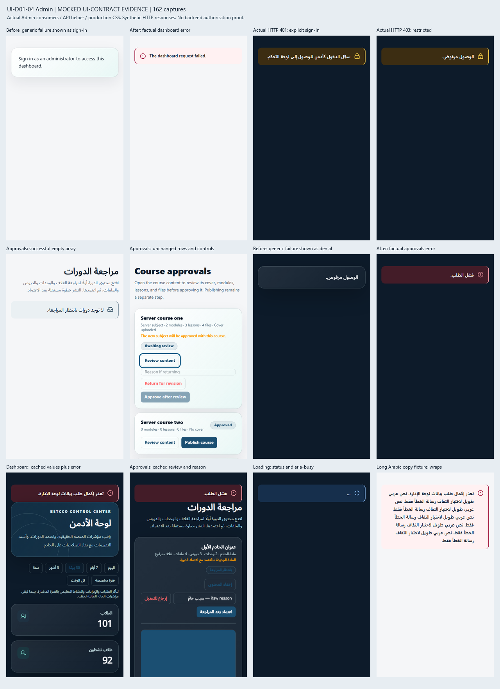

# UI-D01-04 — Admin tranche

The final authorized role/state tranche distinguishes a failed request from actual authentication/authorization evidence. Production scope is only `AdminDashboard`, `CourseApprovals` and their local `AdminRequestFailure` presentation helper in `src/features/admin/admin-area.tsx`, plus two paired EN/AR message leaves. The locked Hybrid BETCCO DC01–DC16 contract, UI-DEEP-01 roadmap row, merged #194 shared/Teacher and #195 Student specimens remain authoritative. UI-D01-05 is not implemented.

## Verified source and ownership

Base and refreshed origin/main: `7464f0d73dabb0e07385d23b85592f568091063c`, including merged #195. The fresh worktree/branch began with behind=0. Every open PR and its files was checked before editing and again before handoff: only #190, `frontend/package.json` and `frontend/pnpm-lock.yaml`, was open. There is no file overlap or competing Admin tranche. Shared Action, QueryState and MutationOutcome are byte-identical to merged #194 (`4470b026df3c795a6191e128f96c29482606ff74`). Dependencies and fonts are unchanged.

`src/app/[locale]/admin/[[...segment]]/page.tsx` renders `AdminArea`, whose existing dashboard/default and `course-approvals` branches select these consumers. No route or guard changes.

## Actual error contract and mapping

`src/lib/api.ts` already exports `ApiError extends Error` with numeric `status` and optional `code`. Failed HTTP responses become `new ApiError(response.status, ...)`; network/abort failures propagate as native errors. Both HTTP 401 and 403 are therefore supported without changing the API client. Only `error instanceof ApiError` supplies status evidence. A generic Error with `status: 401`, or a message mentioning sign-in/access denial, cannot trigger auth presentation.

| Actual query evidence                | Dashboard                                                                     | Course approvals                                                   |
| ------------------------------------ | ----------------------------------------------------------------------------- | ------------------------------------------------------------------ |
| Pending, no data                     | QueryState loading; existing loading copy                                     | Same                                                               |
| Cold HTTP 401                        | Restricted QueryState; existing dashboard sign-in text                        | Restricted QueryState; explicit paired sign-in text                |
| Cold HTTP 403                        | Restricted QueryState; existing access-denied text                            | Same                                                               |
| Cold 5xx/404/network/timeout/unknown | Error QueryState; factual dashboard request failure                           | Error QueryState; existing generic request failure                 |
| Successful data                      | Existing dashboard, periods, totals, charts and destinations                  | Existing server-ordered rows and controls                          |
| Successful `[]`                      | Not a dashboard payload contract                                              | Empty QueryState; no denial                                        |
| Cached data, refresh fails with 401  | Preserve dashboard; factual request-error notice, no replacement sign-in page | Preserve rows/review/reason/actions; factual request-error notice  |
| Cached data, refresh fails with 403  | Preserve dashboard plus factual restricted notice                             | Preserve rows/review/reason/actions plus factual restricted notice |
| Cached data, other refresh error     | Preserve dashboard plus factual error notice                                  | Preserve rows/review/reason/actions plus factual error notice      |

Real QueryClient tests establish that these queries retain their successful data after a failed refresh. The cached-401 presentation policy preserves useful factual cached data, as requested; it does not infer current session validity or authorization. The server remains authoritative for every request and mutation. No cache policy, query option, retry, redirect or permission behavior changes.

There were no query retry controls in these target states. No retry action is added. No Action/actionClassName or MutationOutcome adoption is justified in these query-only seams; every existing button, disabled expression, callback and local mutation outcome is retained. There is no broad Admin migration.

Exactly two new leaves per language: `adminWorkspace.dashboard.requestError` and `adminWorkspace.courseApprovals.signIn`. Existing dashboard sign-in, access denial, generic approvals request error and all other message values remain unchanged.

## Preserved contracts and historical gates

Dashboard period/custom date initialization, range validation, inclusive UTC boundary, complete query key/string, raw server values, metric/chart order and 18 navigation destinations are unchanged. Course approvals query key/path, server order, selectedCourseId, raw reasons, review/publish eligibility, methods, payloads, mutation/onSuccess sequencing and invalidations are unchanged. CourseApprovalPreview is unchanged.

An independently captured main source hash is restored only by exact reviewed state hunks. Missing, duplicated or modified hunks leave the source unprojected; unrelated changes remain in the whole-module hash. Negative mutations cover broad auth classification, forged status evidence, cached-data early returns, keys, payloads, methods, review guard, selected course, dates and destinations. Independent byte hashes protect API/shared/Student/Teacher/AI/navigation/CSS/fonts/manifests.

Historical i18n and Student/shared ownership gates compose this exact Admin projection. Their original fixtures, baseline hashes, inventory and business-contract assertions remain. The final Admin literal audit's compiler host optionally projects exact reviewed Admin source before its historical audit; default callers remain unchanged. Exactly two approved copy leaves are projected with exact-value checks. No namespace or arbitrary literal is exempted. New actual-API state regressions independently test the current unprojected implementation.

## Verification

Focused state, translation, source and historical protection runs: **389/389 across 11 files**, including 65 new Admin state/source cases. HTTP cases use the real API helper, Response and ApiError; only fetch is synthetic. Both locales cover pending, successful data, cold 401/403/500/404, native network/timeout/unknown errors, successful empty approvals and retained cached data after 401/403/503. Cached approvals retain the open review, raw reason, control eligibility, order and destinations. No mutation is triggered by any query-state test.

The final full suite passed **2539/2539 across 104 files** in 178.47s, with two existing jsdom navigation notices. `pnpm exec eslint . --max-warnings 0`, `pnpm typecheck` and `pnpm build` passed. `pnpm format:check` and `git diff --check` are checked after this documentation update. These are local verification results; required remote CI and independent review remain separate gates.

**MOCKED UI-CONTRACT EVIDENCE:** 162 actual-browser captures using AdminArea, real QueryClient/API helper/next-intl, production CSS and unchanged local fonts. Core states cover EN/AR × Light/Dark × 1440×900 and 390×844. Data/error counterparts also cover 834×1112; four error captures use equivalent 200% viewport/DPR reflow. Before/after captures use the independently saved merged-main component with unchanged current shared primitives. Two further mobile captures use harness-only extended Arabic error copy to verify wrapping; production messages are unchanged.

No page errors or horizontal overflow occurred in the recorded matrix. All eight matched successful-data mobile text/action/destination sequences are identical. Cached-error captures retain data alongside the factual notice; the old baseline instead replaces cached data with sign-in/denial. Loading uses role=status and aria-busy; generic errors use role=alert; restricted states include explicit text and a lock icon, without color-only meaning. Long Arabic fixture copy wraps in both themes. Twenty-four keyboard focus checks preserve the existing controls' 3px outline and 3px offset. Minimum sampled state text contrast is **12.321:1**, icon contrast **6.607:1**, state-border/surface contrast **3.441:1** and painted focus/adjacent contrast **6.754:1**. Contrast claims cover the touched QueryState surfaces and sampled existing focus, not legacy dashboard/approval buttons or every other page element.

The deterministic harness disables retries/window-focus refresh only in its test QueryClient and explicitly refetches the same production keys for cached failures. It intercepts synthetic HTTP responses, including real HTTP-status conversion by the production API helper. It does not prove full Next routing/SSR/CSP, backend authorization, permissions, database persistence, payments, deployment, all browsers or whole-site WCAG. Reflow is equivalent viewport/DPR evidence, not native zoom automation. All 162 full screenshots and detailed metrics remain local task artifacts; the contact sheet below is the reviewable subset.

## Changed files

| File                                                                     | Reason                                                                            |
| ------------------------------------------------------------------------ | --------------------------------------------------------------------------------- |
| `src/features/admin/admin-area.tsx`                                      | Two target consumers and local factual request-state helper                       |
| `messages/en.json`, `messages/ar.json`                                   | Two exact paired state leaves each                                                |
| `tests/admin-state-adoption.test.tsx`                                    | Current real-API/QueryClient regression matrix                                    |
| `tests/admin-state-contract.test.ts`                                     | Exact projection, negative mutations, frozen-file and copy contracts              |
| `tests/fixtures/ui-d01-04-admin-baseline.json`                           | Independent main hash, exact reviewed seams, approved leaves and protected hashes |
| `tests/helpers/admin-state-projection.ts`                                | Exact source/copy projection for historical assertions                            |
| `tests/admin-dashboard-translation.test.tsx`                             | Generic failure expectation and actual ApiError export                            |
| `tests/admin-evaluations-approvals-translation.test.tsx`                 | Real ApiError(403) denial fixture                                                 |
| `tests/admin-dashboard-source-audit.test.ts`                             | Preserve dashboard source/copy baseline through exact projection                  |
| `tests/admin-evaluations-approvals-source-audit.test.ts`                 | Preserve approvals source baseline through exact projection                       |
| `tests/admin-a5-5-10-15-source-audit.test.ts`                            | Preserve unrelated Admin batch baseline through exact projection                  |
| `tests/admin-final-i18n-residual-audit.test.ts`                          | Project only the reviewed Admin module for historical literal/hash audit          |
| `tests/helpers/admin-final-i18n-audit.ts`                                | Optional compiler-host projection; unchanged default behavior                     |
| `tests/admin-users-source-audit.test.ts`                                 | Preserve historical dashboard copy hash after exact leaf projection               |
| `tests/helpers/metadata-catalogue-projection.ts`                         | Compose exact approved catalogue additions for prior full-catalogue freezes       |
| `tests/student-state-contract.test.ts`                                   | Preserve Student's Admin freeze after exact authorized Admin projection           |
| `tests/ui-interaction-adoption.test.tsx`                                 | Preserve #194 ownership/source/copy baselines through exact projections           |
| `specimens/UI-D01-04-Admin.md`, `specimens/ui-d01-04-admin-evidence.png` | Scope, contract, evidence and closure handoff                                     |

## Closure and deferred work

**UI-D01-04 COMPLETE: YES for all explicitly authorized role/state implementation scope.** Shared/Teacher (#194) and Student (#195, including its blocker correction) are merged. This Admin tranche implements the final deferred consumers. No authorized UI-D01-04 consumer remains unimplemented. This is implementation-scope closure, not merged delivery: Admin remains Draft pending independent review, required remote CI and an authorized merge. Repository-wide DONE/status reconciliation follows those gates; no merged-state status document is changed here.

Unrelated Admin mutation feedback remains deferred: AdminWallet, TeacherInvites, StudentManagement, AdminEvaluations and SchoolIntegrations; imported account/security/privacy/commerce modules are unchanged. This inventory does not authorize their migration. Also unchanged: backend/auth/roles/guards/session/cookies/API, Teacher/Student/Public/navigation, shared primitives, tokens/CSS, dependencies, fonts and AI/RAG.

Next recommended roadmap slice, only after a separate instruction and its own preflight: **UI-D01-05 — Refine role shells and context**. Do not mark Ready, merge, auto-merge or start that slice in this task.
