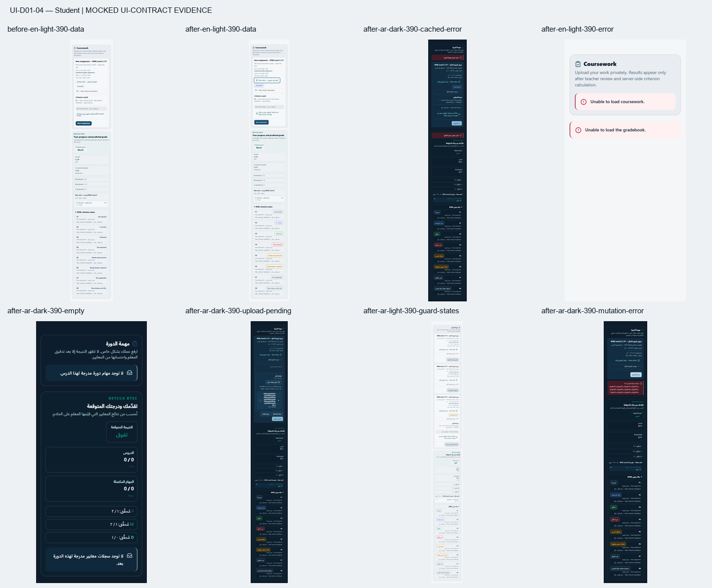

# UI-D01-04 — Student tranche

Student coursework and gradebook state adoption only, continuing merged #194. Admin remains deferred and UI-D01-05 is not started. The locked DC01–DC16 contract, original UI-DEEP-01 roadmap row and merged shared/Teacher specimen remain the authority.

Base main: `04fdcb3b0cca3eb659dd78dd567c3660268e4abf`. Preflight fetched origin, verified #194 MERGED into that SHA, checked every open PR's files and found only #190 (package/lock dependency work). The fresh branch starts at main with behind=0; shared Action and QueryState are byte-identical to #194.

## Discovery and exact production scope

`src/app/[locale]/student/[[...segment]]/page.tsx` renders `StudentArea`. Its existing `learn/{courseId}` branch renders `CoursePlayer`. For an Assignment lesson, CoursePlayer renders `CourseAssignmentPanel`; whenever an actual lesson is present, its secondary region renders `StudentCourseGradebookPanel`. Gradebook is therefore a real Student panel, not an inferred Teacher/Admin counterpart. Their mount conditions, route and neighboring player/formative/AI/evaluation components are unchanged.

Only `src/features/student/student-area.tsx` changes executable production source: these two consumers, their local status-class helper and one existing shared re-export import. A named export makes the existing gradebook consumer available to isolated tests; its production mounting is unchanged. The two message catalogues add exactly three paired Student state leaves, because these previously hidden error/empty branches had no caller copy. No old translation value changes.

| Query owner            | Existing key                                     | Existing source                                           | Previous state gap                                                                                                                      |
| ---------------------- | ------------------------------------------------ | --------------------------------------------------------- | --------------------------------------------------------------------------------------------------------------------------------------- |
| Coursework assignments | `["student-course-assignments", courseId]`       | `/student/courses/${courseId}/assignments`                | Pending or no visible assignments returned null, hiding initial failure and true empty.                                                 |
| Coursework submissions | `["student-course-assignment-submissions"]`      | `/student/assignments/mine`                               | Existing generic load error appeared only when visible assignments survived the early return. Cached submissions were already retained. |
| Student gradebook      | `["student-course-gradebook", courseId, locale]` | `/gradebook/student/courses/${courseId}?locale=${locale}` | Ad-hoc loading; any error returned null, including refresh failure with valid cached data.                                              |

There is no query retry control, pagination, filter/reset or placeholderData in either consumer. No such behavior is added. Tests explicitly refetch the same existing keys through the test QueryClient to prove recovery/cache behavior. Unavailable/restricted are not query-domain branches exposed by these payloads; failed HTTP retrieval remains error. Availability/deadline/resubmission restrictions keep their existing disabled action and explanatory label.

## Adopted presentation

- Coursework exposes shared loading, error and successful lesson-filtered empty states. Rows stay mounted when either query fails after caching. Submission loading/error can coexist with factual assignment information, but the submission-dependent action region requires actual `mine.data`. An unresolved/failed query without data cannot mean "no submission". Valid cached data, including a known-empty array, remains usable after a failed refresh; existing workflow guards then apply unchanged.
- Gradebook exposes loading and initial error. A refresh error appears alongside the cached summary, units, criterion records and open disclosure. A successful zero criterion list gets a scoped empty state while retaining the server-owned summary and genuine zero counters.
- Four native buttons adopt Action. Existing priority stays: start/submit Primary, save/upload Secondary. Two native download links adopt `actionClassName("quiet")`; exact hrefs and raw filenames/resource labels remain unchanged. No link becomes a button.
- Native type, callbacks and every disabled expression remain unchanged. Existing labels are retained during pending; the actual mutation flag supplies `pending` and `aria-busy`, preserving the primary/secondary pair while preventing duplicate activation through the same native disabled guard.
- Existing local mutation errors use MutationOutcome with the same Error.message precedence and fallback copy. There was no local success message to migrate; none is invented. No toast or global notification.
- Static status labels keep their text and meaning. Submitted/InReview/Graded/Finalized use Info (not an achievement claim), NeedsRevision/NeedsImprovement/ResubmissionRequired Warning, Achieved Success, NotAchieved Danger; other states and raw calculated-grade labels use Neutral. Unknown values remain raw. Predicted-grade, P/M/D counters and existing grade/criterion label functions remain unchanged.
- Lucide icons touched in the coursework heading/links use 20/18px and stroke2. All are nondirectional; none is mirrored. Wrapping/min-width adjustments stay within the two consumers and raw mutation-message spans.

All assignment identity, availability/effective deadline calculations, draft/submitted/reviewed distinctions, sequential multipart uploads, file contracts, scan fields, attempts, mutation ordering, invalidations and domain guards remain unchanged. There are no backend, API, formal assessment/evaluation, entitlement, commerce, navigation, Admin, Teacher, AI/RAG, dependency, CSS/token or font changes. Coursework revision controls retain their existing meaning and do not touch the separate formal Resubmission/Resit workflows.

## PR #195 blocker correction

The initial `84d31c5` action region checked only `submission?.status !== "Graded" && submission?.status !== "Finalized"`. Both comparisons are true when `mine` has not supplied usable data. The earlier tests missed this because their cold-failure fixture supplied no assignments. New deferred-query regressions reproduce six failures in EN/AR before the correction.

The production correction adds only `mine.data &&` before those same status checks. It hides Start/Continue/Revision and the active submission form while submission data is unknown, while retaining factual assignment information and the existing loading/error state. It does not require `mine.isSuccess`, so a refresh error does not disable workflows backed by actual cached data. No query option, key, API path, payload, mutation callback/order, deadline, revision permission, file contract, label or message changes.

The regressions cover assignments-first/pending mine; cold mine failure with/without a failed assignment refresh; cached Draft/Submitted/NeedsRevision with failures of either query; and successful `[]` with open/not-open/past-due guards. Cached workflows remain enabled and perform the unchanged POST after explicit user activation. Raw statuses, deep links and server order remain visible. The exact source projection adds only the reviewed data guard; negative mutations reject removing it or replacing it with `mine.isSuccess`.

## Verification and evidence

Focused verification after the blocker correction passed **181/181 across eight files**, including 61 Student state/source cases added by this PR (20 added for this correction) and retained coursework localization/deadline/guard/player/shared primitive regressions. The required full suite passed **2474/2474 across 102 files** in 164.05s, with two existing jsdom navigation notices. `pnpm format:check`, `pnpm exec eslint . --max-warnings 0`, `pnpm typecheck`, `pnpm build` and `git diff --check` passed again for the correction. Documentation formatting is checked once more after this results update.

The complete source projects back to the independently captured main hash only through exact reviewed presentation hunks. Any missing, duplicate or altered hunk remains unprojected. Negative mutations cover transport/query keys, multipart field/order, disabled/date guards, destinations, raw errors, statuses and frozen AI code. Historical T7 and #194 guards compose this exact projection; old fixtures and original assertions are retained. Exactly three paired catalogue leaves are projected with exact-value checks; every unrelated value remains in historical full-catalogue proofs. Shared/Teacher/Admin/AI/formal helpers, route, FilePicker, API, CSS and manifests have independent byte hashes.

**Original-tranche MOCKED UI-CONTRACT EVIDENCE:** 92 captures at `84d31c5` of the actual two Student consumers, real QueryClient/API helper/next-intl and unchanged generated production CSS. EN/AR × Light/Dark, 1440×900, 834×1112, 390×844 and equivalent 200% reflow. Loading/error/empty/data/cached failure, active draft, disabled upload, start/upload pending, mutation error, domain-disabled actions, reviewed grade, criterion states and keyboard focus are exercised. There are no page errors or horizontal overflows in those recorded cases. All adopted actions sampled are at least 44px; enabled opaque actions and states pass sampled contrast. Sixteen actual Quiet-link focus checks verify the immediate 3px outline/2px offset against painted adjacent pixels. That original matrix did not cover assignments-first with unknown submission data. The blocker is covered by the explicit current regression tests above; no new browser matrix is claimed for this guard-only correction.

All 12 matched before/after destination sequences are identical; the four successful-data text sequences are identical. Sampled enabled opaque action contrast is at least **8.065:1**, state/status contrast **6.607:1**, painted focus/adjacent contrast **7.042:1** and painted Quiet-link text contrast **6.568:1**. These measurements apply to the touched surfaces, not untouched predicted-grade/metric/legacy text.

The harness intercepts synthetic GET and POST data, disables retry/window-focus refetch for deterministic evidence, and explicitly refetches existing queries for cached failures. It adds a harness-only named export to the exact old private gradebook function for before captures. Production query defaults and source are unchanged. It supplies Next browser constants but does not prove full Next routing/SSR/CSP, server authorization, real uploads/security scans, database persistence, payment, deployment, every browser or whole-site WCAG. Reflow is equivalent viewport/DPR evidence, not automated native zoom. Existing player/panel typography, predicted-grade tones and legacy containers remain outside this adoption.

## Handoff boundary

Commit/push/Draft only after all required checks pass. Independent review and required remote CI remain separate gates. Do not mark Ready, merge, enable auto-merge, begin Admin or start UI-D01-05. The next recommended task is UI-D01-04 — Admin tranche after a separate instruction.
