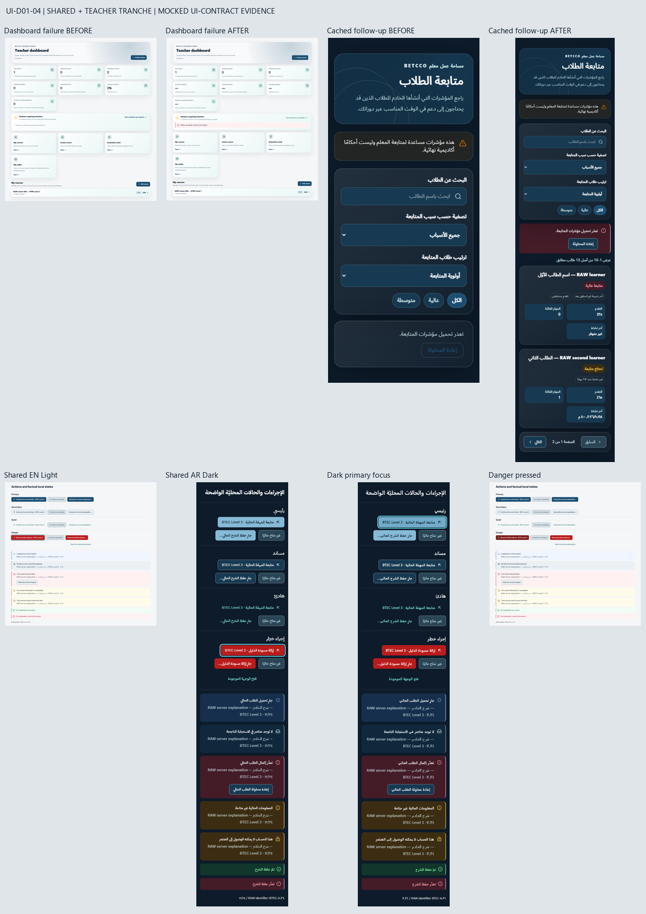

# UI-D01-04 — Standardize action, status and query-state adoption

**Shared primitives + Teacher tranche.** This is one role-scoped Draft handoff, not completion of all UI-D01-04 consumers. The original completed `UI-DEEP-01-Modernization-Roadmap.md` explicitly says: “split per role rather than editing all branches in one PR.” Student coursework/gradebook and Admin failure-versus-unauthenticated branches remain deferred under UI-D01-04. UI-D01-05 is not started.

## Authority and production boundary

Exact roadmap goal: stop failed requests masquerading as healthy zero/empty/sign-in states; unify clear feedback while keeping cached data. The row names Action/QueryState, Teacher area/follow-up, and scoped Student/Admin branches. Dependencies: UI-D01-01/02 and merged #191 reconciliation; this tranche also consumes merged UI-D01-03 typography. Complexity Medium; business risk Low–Medium while presentation-only. Required failed-query/cache/retry/focus checks and purposeful EN/AR, Light/Dark, desktop/tablet/mobile evidence apply.

Base main: `e6099753e4f6d829c8acd80ffece29185d8c23aa`, merged #193. Preflight verified #193 MERGED, only #190 open and no changed-file overlap. #190 owns only `frontend/package.json` and `frontend/pnpm-lock.yaml`. A fresh clean worktree and branch were created from this exact main. The locked DC01–DC16 contract and merged UI-D01-02/03 notes were read; neither foundation is recreated or globally redefined.

Only four production files change:

- `src/components/ui/action.tsx`: visual state classes only; existing native API/behavior stays intact.
- `src/components/ui/query-state.tsx`: shared state and local outcome presentation only.
- `src/features/teacher/teacher-area.tsx`: Dashboard count availability, preview error evidence and Create Course link styling only.
- `src/features/teacher/teacher-student-follow-up.tsx`: scoped query branches, known attention-label styling, retry/reset/pagination and View All link adoption.

All CSS, color/type tokens, fonts, layouts, catalogue/dashboard wrapper/Support source, Student/Admin source, course-management source, API helper, translations, package and lock files remain byte-identical. No backend, schema, navigation registry, commerce, assessment, evaluation, privacy/security or AI/RAG work is included.

## Actions

The Primary/Secondary/Quiet/Danger API is unchanged. Primary adopts the complete opt-in `action-primary-surface` / `action-primary-foreground` family, including matching hover/pressed surfaces; it does not mix compatibility foreground values into the target family. Catalogue `text.onImage` and legacy aliases remain protected and unchanged. Secondary, Quiet and Danger use their existing semantic roles and explicit hover/pressed values. No brightness filter substitutes for a reviewed state pair.

Native buttons and helper-styled native links both receive hover/pressed presentation. Disabled/pending buttons cannot acquire the enabled hover/pressed treatment. Disabled uses its approved surface/text without extra opacity; pending retains its own variant and caller-owned progress label. `disabled || pending`, `aria-busy`, default button type, form behavior, caller props/children and destinations are unchanged. No handler, permission or pending guard is introduced or removed.

Actions adopt 8px radius, minimum 44px height and 120ms background/border/text transitions. Focus color is immediate: a browser check caught the transient low-contrast outline caused by including outline-color in the generic color transition. Reduced motion removes the transition. The existing 3px semantic focus outline is retained, with a component-local important 2px offset to match the locked contract despite the legacy unlayered focus rule. No global radius/focus/reset rewrite occurs.

## Status, QueryState and mutation outcomes

| Kind                   | Existing meaning retained | Role / busy             | Presentation               |
| ---------------------- | ------------------------- | ----------------------- | -------------------------- |
| loading                | A pending retrieval       | status / true           | Info pair + Loader         |
| empty                  | Successful empty response | No explicit role / busy | Neutral pair + Inbox       |
| error                  | Failed request            | alert / no busy         | Danger pair + CircleAlert  |
| unavailable            | Information unavailable   | No explicit role / busy | Warning pair + Info        |
| restricted             | Access restricted         | No explicit role / busy | Warning pair + LockKeyhole |
| local mutation success | Existing local success    | status                  | Success pair + CircleCheck |
| local mutation error   | Existing local error      | alert                   | Danger pair + CircleAlert  |

State selection, icon identity, roles, caller text/ReactNodes and optional recovery nodes stay intact. QueryState uses an opaque semantic soft surface, logical start border, 12px radius, Label title and Body description. Local MutationOutcome retains its existing native role with an opaque semantic soft surface and 8px radius; it remains local feedback, with no toast or global notification framework. Icons are 20px with stroke 2. Long explanations can wrap and are never pill-shaped.

Only existing Teacher attention labels migrate to semantic pairs. Detailed High remains danger (previous red), Medium remains warning (previous amber). The existing compact preview keeps its warning treatment for both labels. The server's risk level and labels are unchanged. NYA/formative reasons, outcomes, P/M/D, formal grades and evaluation states are not remapped; the formative renderer is hash-protected. No new global Status component or domain-to-color inference is introduced.

## Truthful Teacher branches

- Failed analytics without data show placeholders rather than four healthy zero values. Failed course retrieval without data similarly leaves the three course counts unavailable. Successful zeros remain zeros; valid cached values remain visible.
- Dashboard follow-up retains its existing region/header/View All destination during failure. The preview receives the caller's actual error flag and presents QueryState locally. Failure does not fall through to “no follow-up signals”; cached students remain visible alongside the scoped error.
- Follow-up retrieval errors are independent from the data/empty branch. A cold failure shows the existing localized error and recovery action. A background refresh failure keeps cached rows, count, labels and pagination while reporting the error. Successful empty responses use QueryState with the existing reason/reset copy.
- The existing `result.refetch()` callback is retained. No Dashboard retry control, query options, automatic retry, polling, fan-out, cache mutation, filter/reset behavior, sort, page size, query path/key or pagination guard changes.
- Wallet and evaluation code after the Dashboard are hash-protected; all Teacher query/mutation option expressions and the formative/metric helper functions are compared with the exact merged baseline.

## Regression boundaries

`ui-d01-04-baseline.json` records actual merged-main shared source, protected hashes, Teacher hook expressions and untouched domain sections. `ui-d01-04-presentation-seams.json` contains only exact reviewed visual fragments. A missing/duplicated/changed fragment remains unprojected; complete syntax comparison still detects disabled/ARIA/default-type/raw-content/icon-map drift. Negative mutations verify this. The UI-D01-03 full syntax proof composes this exact presentation projection before its existing typography seams. There is no arbitrary class/string erasure.

The Teacher technical-string inventory changes only for the two authorized files, recording new import/class/variant/kind tokens and removing their obsolete tokens. Its zero untranslated UI text, exact locale/server branches and protocol checks remain strict. No production translation catalogue or historical UI-D01-03 fixture is modified.

## Validation

- Focused tests: **138/138 across seven files**, including 34 new interaction/query-state cases and existing Teacher/i18n/typography regressions.
- Full required `pnpm test --maxWorkers=2`: **2413/2413 across 100 files** on final production/test code; two existing jsdom navigation notices, zero failures.
- `pnpm format:check`, `pnpm exec eslint . --max-warnings 0`, `pnpm typecheck`, `pnpm build` and `git diff --check`: passed. Documentation formatting is checked again after this results block.
- **92 PNG captures from 68 core cases**, including 24 additional hover/pressed/focus images and 26 matched baseline/current pairs. Shared primitives and Teacher Dashboard/follow-up cover EN/AR, Light/Dark, desktop 1440, tablet 834 and mobile 390, plus four equivalent-200% reflow samples.
- **192 enabled Action color-state measurements**, including sampled painted backgrounds: minimum text contrast **5.508:1**. Across 112 state/outcome pairs, minimum body text **6.812:1**, state-icon foreground **6.607:1**. These are touched opaque component contexts, not site-wide contrast certification.
- **64 keyboard-focus checks:** 3px outline and 2px offset, with immediate outline/canvas contrast at least **6.994:1**. Sampled Action minimum height **44px**. All core captures have no horizontal overflow/browser page errors; reduced-motion transitions are removed. Disabled/pending semantics and variant retention pass.
- Matched shared copies are identical; all 26 matched destination sequences are unchanged. Actual cold/cached query errors and retained rows are recorded. Requests in the fixture are GET-only; no backend/domain claim follows.
- Every protected source hash matches the actual merged Git blob, not just the working copy. No font/dependency/token/translation/deferred-role or unrelated module changes.

**MOCKED UI-CONTRACT EVIDENCE.** The fixture renders actual baseline/current shared primitives and Teacher consumers with unchanged generated production CSS, the real API helper, QueryClient and next-intl. API GET responses are fixed synthetic data. The test QueryClient disables retry/focus refetch for deterministic capture and explicitly refetches the same query for cached failures; production query options are unchanged. Font cache is warmed once. Vite supplies Next's browser environment constants; this is not full Next routing/SSR/CSP or deployed integration evidence.

Reflow samples use equivalent half-size CSS viewports at DPR 2; native browser zoom controls were not automated. Browser evidence is Chromium on Windows. It does not establish backend authorization, persistence, entitlement, payment, deployment, all-browser behavior, green remote CI or whole-platform WCAG conformance.

## Deferred consumers, risks and stop

Student coursework/gradebook and Admin failed-request versus actual unauthenticated branches remain separate UI-D01-04 role tranches. Their required screenshots/regressions are not claimed here. Shared primitive styling naturally reaches existing callers, but their local state-selection branches are not migrated.

Within Teacher, search/segmented-filter/disclaimer presentation, course-management internals, wallet, evaluation/review and formative practice regions remain unchanged and deferred to their own authorized work. Existing legacy containers may remain glass/heavy; this PR adds no glass or page-composition redesign. UI-D01-11 hierarchy/density work is not started.

Shared visual changes can affect existing Action/QueryState callers; complete native/caller contract checks and the required full suite cover that boundary, with limited rendered consumer coverage. Pending width still depends on caller-owned labels, as before. Broader consumer/browser validation and required remote CI/independent review remain separate gates.

Draft only. Do not mark Ready, merge, enable auto-merge or start UI-D01-05. Continue remaining UI-D01-04 roles only after this tranche's review/merge and a separately scoped next instruction.
