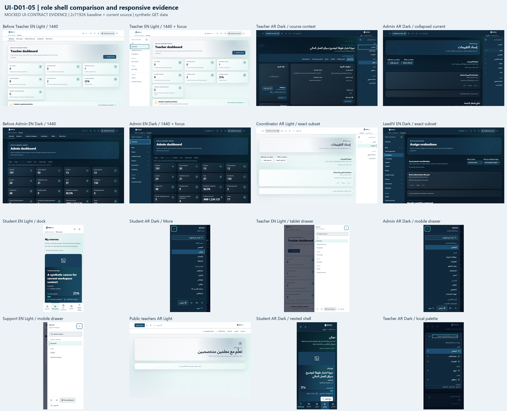
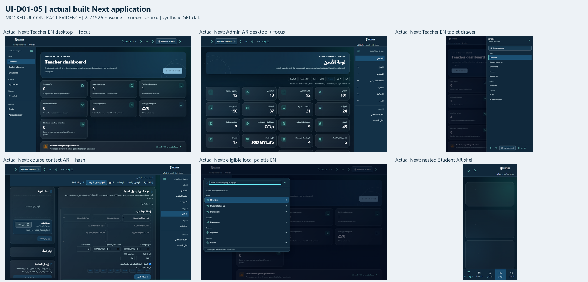

# UI-D01-05 — Refine role shells and context

Implemented for independent Draft review only. The delivery is not merged and no subsequent roadmap slice is implemented. All browser results below are **MOCKED UI-CONTRACT EVIDENCE**.

## Authority and fresh preflight

The authoritative `UI-DEEP-01-Modernization-Roadmap.md`, UI-D01-05 row, states:

- **Exact title:** UI-D01-05 — Refine role shells and context.
- **Goal:** retain Student mobile dock; introduce approved compact Teacher/Admin desktop shell; clarify groups, entity context and return paths.
- **Production scope:** `components/site-navigation.tsx`, `components/navigation/workspace-navigation.tsx`, `use-dialog-focus.ts`; detail headers in role areas. Exact public `/teachers` classification belongs to its separately approved prerequisite. Existing palette local destinations and Teacher editor local presentation are included by the authorized continuation.
- **Dependencies:** UI-D01-01/02/03; D10; verified current role/capability contract. The locked DC08 specifies 240px Teacher and 256px Admin desktop sidebars at 1024px and above, with drawers below that breakpoint. Student retains its distinct dock/grouped model.
- **Required screenshots:** public teacher directory; Student desktop/mobile dock/More; Teacher/Admin desktop/tablet/mobile; full Admin, coordinator-only, LeadIV and Support variants.
- **Required tests:** existing shell/navigation tests; exact route-prefix boundaries; native links/current states; keyboard drawer/disclosure focus restoration; locale query/hash preservation; no role privilege expansion.
- **Size/complexity:** Medium-high; route-classification repair is separate from shell redesign.
- **Contract/business risk:** Medium; auth-adjacent visibility and navigation reachability.

Preflight and final fetch both resolved `origin/main` to **`2c71926cd6908a7e103e8da66709f3a40f0665a2`**. This contains the independently merged #197/UI-D01-05G exact Teacher path-segment predicate. Its predicate and two call sites remain unchanged. No material prerequisite remains blocked.

The fresh worktree `C:/Dev/Betcco-UI-D01-05-IA` and branch `fix/ui-d01-05-role-navigation-ia` started clean at that SHA, ahead=0/behind=0. Neither previous local branch was reused. The only other open PR at preflight and final inspection was #190, head `9c7a9eeac776ea07099df1a0f57f5a2da82177f2`. Its body and all changed files were inspected: `frontend/package.json` and `frontend/pnpm-lock.yaml` only. Neither is changed here; no competing shell/navigation ownership was found.

## Result and exact role sets

| Shell                                 | Preserved destination count | Presentation                                                                                         |
| ------------------------------------- | --------------------------: | ---------------------------------------------------------------------------------------------------- |
| Public guest                          |  7 established global links | Existing public groups, Subjects, Login and catalogue behavior; `/teachers` stays public             |
| Student                               |                          13 | Four primary links plus existing More; Learning & activity and Account groups; no staff sidebar      |
| Teacher                               |                           7 | Work: Overview, Student follow-up, Evaluations; Courses; Finance: Wallet; Account: Profile, Security |
| Admin / SystemAdmin                   |                     23 each | Pinned Overview; Work, People, Academic setup, Finance, Governance, Publishing; separate Account     |
| CourseReviewer coordinator            |                           3 | Evaluations, Profile, Security only                                                                  |
| LeadInternalVerifier                  |                          22 | Existing set without evaluator-specialisms                                                           |
| CourseReviewer + LeadInternalVerifier |                          22 | Exact existing combined-role set                                                                     |
| SupportAdmin                          |                           3 | Existing Accounts, Profile, Security; compact top navigation/tablet and mobile drawer                |

The original eligible registries and role predicates remain authoritative. Grouping filters only the already eligible link array. There is no replacement authorization registry. Independent fixture expectations are transcribed from starting main, not exported from production code. Group membership does not grant access.

Teacher/Admin use an opaque, full-label sidebar at desktop widths, with a shared global utility header. Hiding the sidebar removes its gutter and focuses the labeled Menu reopening control; reopening focuses Hide navigation. Below 1024px the sidebar and gutter disappear, including at 834px, and the existing drawer presents the full eligible set. Main content and footer use logical start margins; RTL moves the sidebar to the right. The complete public navigation is not duplicated in these operational shells.

Admin initially expands only the containing current group. A current group can be collapsed while retaining `aria-current`, its label and a check marker; other groups do not become permanently expanded. Ordinary nonmodal disclosures retain native buttons, `aria-expanded`, Escape/outside dismissal and trigger focus restoration. Links retain native destinations and `aria-current="page"`; selected borders, font weight and group check indicators supplement color.

Student retains Overview, Courses, Evaluations and Planner in the mobile dock plus the existing Open menu/More control. Its 13 destinations, their order, AI route/eligibility/label and nested learning-to-Courses current context remain unchanged. Support receives no Admin links. Public utility/query/cart/logout/account behavior remains unchanged.

Teacher course context remains a separate local plane beneath the role shell. Existing course title and Back to dashboard content are untouched. The same six hashes, section order, hashchange handling and scroll semantics remain: details, access, announcements, curriculum, assignments, review. The local label, opaque surface and current marker distinguish these anchors from global workspace destinations.

The command palette receives the current shell's already eligible groups. Local choices precede explicitly labeled public catalogue choices and are filtered in memory. Ctrl/Cmd+K, arrow/Enter selection, Escape, backdrop/close and focus restoration remain. The existing public catalogue query, threshold, key, options, endpoint and retry behavior remain exactly unchanged. Opening the palette adds no request; a two-character search still makes the existing catalogue request. Eligible local matches remain usable alongside its pending/error state.

The existing modal focus helper now also makes background branches inert while open and restores each branch's prior inert state. Its trap, initial focus, Escape, scroll restoration and focus return are reused; no second focus trap was introduced. Drawer-to-palette transitions are covered.

## Bounded files

Exactly eight production files change:

- `src/components/site-navigation.tsx`: existing-link grouping, role shell presentation, desktop hide/reopen focus, utility label/target refinements and eligible palette inputs. Role checks, queries and merged UI-D01-05G predicate are retained.
- `src/components/navigation/workspace-navigation.tsx`: staff sidebar, current group disclosures, shared semantic link/group presentation and retained Student dock.
- `src/components/navigation/use-dialog-focus.ts`: background inert/restoration within the existing modal helper.
- `src/components/navigation/command-palette.tsx`: grouped local choices from passed eligible links; existing catalogue query unchanged.
- `src/features/teacher/course-workspace-navigation.tsx`: distinct local navigation presentation; existing hash/section logic retained.
- `src/app/[locale]/layout.tsx`: logical responsive main/footer gutter only; MFA boundary, metadata, providers and data setup retained.
- `messages/en.json` and `messages/ar.json`: 14 paired role-shell copy leaves under one additive namespace; all previous values retained.

New proof files are `tests/role-navigation-ia.test.tsx`, `tests/role-navigation-contract.test.ts`, `tests/e2e/role-navigation-ia.spec.ts`, `tests/fixtures/role-navigation.ts`, `tests/fixtures/role-shell-runtime.ts`, `tests/fixtures/ui-d01-05-role-shell-baseline.json` and `tests/helpers/role-shell-projection.ts`.

Historical tests now apply the exact reviewed source/copy projection before their original assertions: `admin-state-contract.test.ts`, `teacher-route-boundary-contract.test.ts`, `shared-shell-source-audit.test.ts`, `metadata-source-audit.test.ts`, `teacher-residual-source-audit.test.ts`, `ui-bilingual-typography.test.tsx`, `ui-interaction-adoption.test.tsx` and `helpers/metadata-catalogue-projection.ts`. Original fixture hashes and assertions are not refreshed or removed. Missing, altered or duplicate approved hunks fail projection. Separate AST comparisons protect every existing query/mutation/API/router call and eligible registry/predicate; 23 protected file hashes freeze routes, MFA, dashboards, editor logic, API, AI, primitives, CSS, fonts and manifests.

This document, two contact sheets and `ui-d01-05-evidence.json` contain the portable handoff evidence. No dependency, global CSS, token or font file changes.

## Rendered evidence

Fresh baseline and implementation captures total **182**, with no recorded failures, horizontal page overflow, JavaScript page errors, unexpected auth redirects or writes in the captured matrix. The source baseline is the actual preflight SHA, not reused UI-DEEP audit images. Current-source hashes, individual image hashes and scenario metadata are recorded in `ui-d01-05-evidence.json`.

The matrix covers EN/AR × Light/Dark at 1440×900, 834×1112 and 390×844: Student dock/More/nested shell; Teacher/Admin full/sidebar-hidden/current-group/drawer states; coordinator, LeadIV and Support; logged-out `/teachers`; local course context and palette. It also records reduced motion and equivalent 200% viewport/DPR reflow. Fresh matched baseline/after main text is identical for Student course hub and Teacher/Admin dashboard fixtures; content order is not redesigned.

The separate component harness renders actual source components, role feature consumers, QueryClient, API helper, intl, production CSS, fonts and local brand assets. It mirrors the exact saved/current Server Layout wrapper and main classes, while replacing Next hooks and link/image adapters for fixture execution. Missing unrelated editor subpanels explicitly return503 and show factual errors. Its Student nested-path specimen renders the unchanged CourseHub body to test shell context; it is not CoursePlayer workflow evidence.

Actual built Next integration adds **34 passing browser tests** and 32 captures. This includes the unchanged six public `/teachers`/protected Teacher regressions, exact mobile eligible sets for nine role fixtures in both locales, sidebar/main/footer geometry, desktop hide/reopen focus, full-width tablet/drawer behavior, actual local palette navigation, six native course anchors, locale query/hash retention and actual nested Student routing/current dock. Native links, App Router, actual layout/MFA consumer and built CSS are exercised there. API data is synthetic, including guest401 and `requiresMfaEnrollment:false` fixtures; this does not establish server authorization or MFA-policy correctness.

Measured affected navigation controls meet the 44px target check. The minimum sampled text contrast is **6.38:1**; 16 keyboard-focus captures have a minimum sampled outline contrast of **7.56:1**. Drawer tests cover initial focus, forward/backward containment, Escape, close, focus return, scroll and inert restoration; source and component tests retain ordinary disclosure behavior. Reduced-motion measurements are effectively immediate (existing global override ≤1ms). This is scoped interaction/contrast evidence, not a whole-site WCAG certification, all-browser audit or backend/production verification. Equivalent reflow is not native browser zoom. Unrelated dashboard/editor content and its existing styling are outside the navigation audit.

Raw evidence is retained in the task workspace at `outputs/UI-D01-05-IA/visual-evidence.json`, `screenshots/` and `next-browser/`; validation logs and capture scripts are in `work/ui-d01-05-ia/`. The portable sheets and hashed scenario index are committed. Actual-Next checks are reproducible through the committed Playwright spec against the built app; this task used the isolated port3015, preserving the user's existing port3000 service.

## Validation and stop boundary

Focused checks preceded the full suite: the final existing/new 11-file set passed 225/225, four additional locale cases passed in the 28-case IA run, and the final repair set passed 76/76 including both historical source audits. Together these cover **260 distinct tests across 13 focused files**; their final versions also passed in the full run.

| Check                                                | Result                                                                              |
| ---------------------------------------------------- | ----------------------------------------------------------------------------------- |
| `pnpm test --maxWorkers=2`                           | PASS: 2635/2635, 108 files, 191.20s; two existing jsdom document-navigation notices |
| Actual Next Playwright shell + public boundary specs | PASS: 34/34, 24.7s                                                                  |
| Fresh visual matrix                                  | PASS: 182/182, all four locale/theme combinations                                   |
| `pnpm format:check`                                  | PASS after final evidence/documentation formatting                                  |
| `pnpm exec eslint . --max-warnings 0`                | PASS, zero warnings                                                                 |
| `pnpm typecheck`                                     | PASS                                                                                |
| `pnpm build`                                         | PASS, all routes generated                                                          |
| `git diff --check`                                   | PASS                                                                                |

Routes changed: **NO**. Role eligibility changed: **NO**. Authorization changed: **NO**. Permissions changed: **NO**. Business logic changed: **NO**. Query/API/mutation contracts changed: **NO**. Dependencies changed / #190 overlap: **NO**. AI/RAG touched: **NO**. Dashboard content or progress redesigned: **NO**. `/en/teachers` public: **YES**. `/ar/teachers` public: **YES**. Locale query preserved: **YES**. Locale hash preserved: **YES**.

Remaining delivery gates are independent review and remote CI before any separately authorized merge. The user explicitly requires a Draft PR and STOP; do not mark Ready, merge or enable auto-merge. No implementation blocker was found. Server-backed permissions/workflows and whole-site accessibility are not claimed by synthetic shell evidence. Dashboard continuation/density, progress semantics, public page redesign and AI/RAG remain deferred.

The exact next roadmap slice is **UI-D01-06 — Define progress specimens before migrating workflows**. Report only; do not implement it here.
