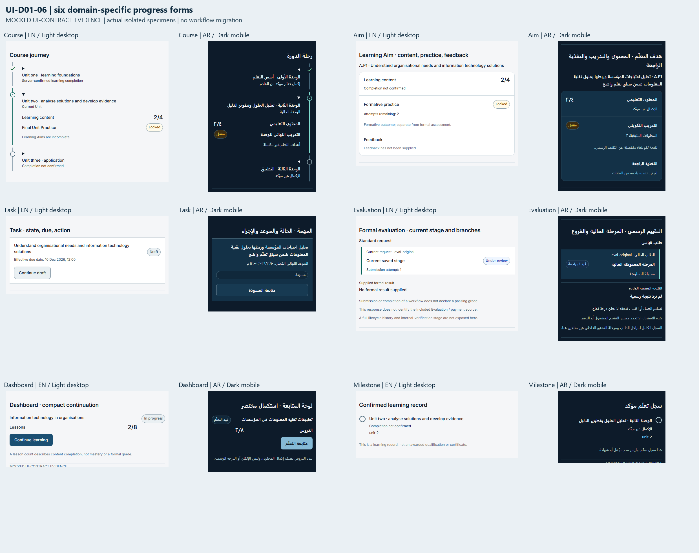
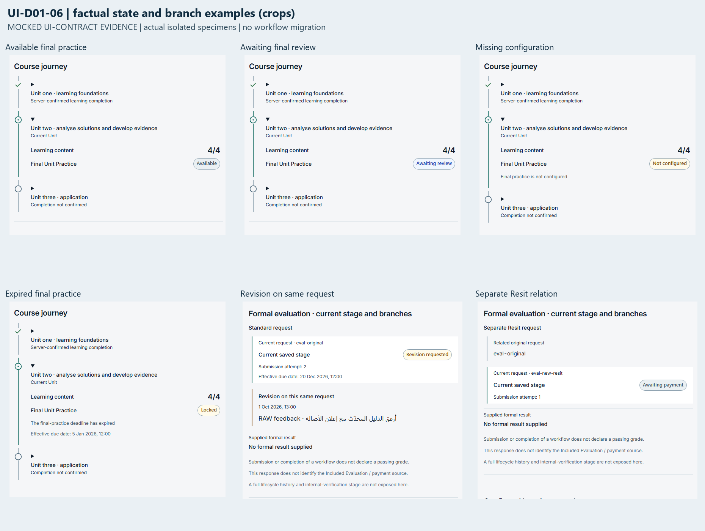

# UI-D01-06 — Define progress specimens before migrating workflows

This is a controlled, isolated specimen slice. It defines six separate progress presentations against current response fields, with no production workflow adoption. **No existing production file changes.** No application route imports these specimens. The user authorizes commit, push, one Draft PR and STOP; Ready, merge, auto-merge and another task are excluded.

## Recovered state and authority

The task resumed in the existing `C:/Dev/Betcco-UI-D01-06` worktree on `fix/ui-d01-06-progress-specimens`, HEAD `40c1457988fc439b175f3a9cd08f4dc9ead1ec6a`, upstream `origin/main`, ahead 0/behind 0. Staged, unstaged and untracked task-file lists were empty; no task commits, remote branch or PR existed. The earlier work had completed the roadmap gate, fresh branch/worktree creation, source-contract inspection and frozen-lockfile dependency installation. The install completed successfully during the interruption. Its log and all earlier task artifacts were retained; installation and branch creation were not repeated. Classification: **A — implementation incomplete**.

The supplied historical reference, actual starting preflight main and fetched resume main are all `40c1457988fc439b175f3a9cd08f4dc9ead1ec6a`. This contains merged #198/UI-D01-05. The only other open PR at preflight/resume is #190, head `9c7a9eeac776ea07099df1a0f57f5a2da82177f2`; its changed files are `frontend/package.json` and `frontend/pnpm-lock.yaml`. Neither overlaps or changes here. No history reset, branch recreation, rebase, force-push or worktree replacement was performed.

The exact authoritative row was read and reported before implementation in this same task, then reused at resume as instructed. Source: task workspace `outputs/UI-DEEP-01-Modernization-Roadmap.md`, lines 92–100:

- **ID/title:** UI-D01-06 — Define progress specimens before migrating workflows.
- **Goal:** accept six progress forms: course rail, Aim checklist, task state/due/action, evaluation lifecycle, dashboard compact ratio and milestone threshold.
- **Scope:** reusable progress/status specimens; `features/student/student-progress-intelligence.tsx`, `student-courses-learning-hub.tsx`, learning-practice modules and evaluation presentation as source contracts.
- **Dependencies:** UI-D01-02/03; D11/D12; server field/meaning mapping. D11/D12 are the six-pattern and functional-motion decisions, subsequently locked by DC09/DC10.
- **Screenshots:** available/locked/in-progress/waiting-review/complete, missing configuration, expired/restricted final practice and revision/Resit branches.
- **Tests:** no percentage substituted for mastery; no generated milestone absent from data; accessible state text; logical RTL direction; reduced motion.
- **Size:** Medium design, Medium implementation later.
- **Risk:** High if semantics change; keep this slice presentation-only.

**ROADMAP GATE: PASS.** The exact title and scope match the authorized continuation. The existing merged fonts, semantic colors, Action/QueryState and navigation remain the foundation. Model identifier, thinking effort and Fast Mode are not exposed to the executor, so the requested runtime settings are not claimed as independently verified.

## Six models and actual field mapping

| Model          | Implemented presentation                                                                                         | Source contract and meaning                                                                                                                                                                                                                                                                                                                   |
| -------------- | ---------------------------------------------------------------------------------------------------------------- | --------------------------------------------------------------------------------------------------------------------------------------------------------------------------------------------------------------------------------------------------------------------------------------------------------------------------------------------- |
| Course journey | Native expandable Unit rail, explicit current Unit, content counts and final-practice state/reason               | `student-progress-intelligence.tsx` types at 18/37/46; `CourseAssignmentsController.cs:303` confirms `isTrainingComplete` is supplied by the server. Unit/Aim identities and order are retained; missing Units produce no invented nodes. Current Unit is an explicit context input, never inferred from a percentage.                        |
| Learning Aim   | Separate content/practice/feedback checklist, attempts remaining, latest/best formative outcomes                 | `learning-aim-practice.tsx:17` and `LearningAimPracticeProgressService.cs:209`. Counts, `contentComplete`, `practiceStatus`, feedback strings and `isComplete` remain distinct. `Submitted` means waiting review; absent feedback stays unsupplied.                                                                                           |
| Task           | Raw localized title, saved status, supplied effective due date and one caller-owned action slot                  | `student-area.tsx:3095` assignment and `:3127` submission contracts. Task `title` is a presentation projection of the existing localized assignment title. No deadline arithmetic or overdue count. Unknown saved status exposes no task action. A known status does not itself create an eligible action.                                    |
| Evaluation     | Saved current stage, actual related request, supplied feedback order/revision loop and independent formal result | `student-area.tsx:4705` MyEvaluations; `student-resit-workflow.tsx` Detail; exact `EvaluationStatus` enum in `backend/src/Betcco.Domain/Common/Enums.cs:43`. Resit is a separate request relation; revision remains on the same request; historical Retake is readable with no creation control. No generated completed stages or timestamps. |
| Dashboard      | Compact lesson numerator/denominator, factual course state and caller-supplied Continue                          | `student-courses-learning-hub.tsx:38`, `StudentCoursesLearningHubContracts.cs:26`. `progressPercent` is accepted as source data but never used to infer mastery, grade, state, access or an action. Actual counts/state are preserved even when a test input disagrees with a percentage.                                                     |
| Milestone      | Compact confirmed Unit learning record; no celebration loop                                                      | Only `unit.finalPractice.isTrainingComplete === true` marks confirmation. All Aims complete, Finalized status, lesson count or 100% alone cannot award it. Missing confirmation remains unknown. The record identifies a Unit; it does not manufacture a qualification, certificate, badge or new stored achievement.                         |

The relevant server producer was inspected: Aim content completion requires nonzero content plus saved lesson completion; Aim training completion also requires an actual reviewed attempt. The final-practice producer supplies availability/reasons and its own completion flag. These producer implementations are unchanged; the specimen does not replicate their eligibility calculations.

The six exported presenters share only small text/state/date helpers. They are not a universal progress widget. There is no percentage ring, generic progress bar, numeric mastery, fake loading percentage, task completion inferred from dates or state derived from animation. Raw IDs, titles, feedback, unfamiliar status strings and outcomes remain raw data. Supplied feedback order is preserved; dates use the existing locale formatter with raw fallback. Counts are not clamped or converted to a passing grade.

## Missing data: bounded parts deliberately stopped

The inspected evaluation list/detail contract does **not** identify the funding source as Included Evaluation versus paid. A zero price cannot prove entitlement or absence of Payment. The specimen explicitly says that this information is not exposed; it does not invent a funding branch. Likewise the current DTO does not provide a full lifecycle/IV history, so there are no fictitious historical steps, responsible staff, deadlines or SLA timestamps. Only actual feedback timestamps are shown. A richer lifecycle would require a separately authorized, explicit projection; none is created here.

The progress response supplies Unit/Aim IDs but not a ready-to-use eligible next-step destination for every stage. Unit/Aim direct-action integration is therefore not implemented from a guess. Existing workflow consumers would retain ownership of their contextual routes/guards during any future authorized adoption. Task and dashboard action slots never construct business actions; the isolated showcase supplies native fixture anchors only. No actual submit, upload, payment, enrollment or evaluation action occurs.

There is no new earned-award ledger in these snapshots. A persistent Unit confirmation can be represented from the existing server flag; arbitrary earned milestones, threshold rewards, certificates and acknowledgment persistence are not fabricated. Incomplete stage data stays incomplete. This is the required missing-data boundary, not an invitation to change the backend in this task.

## Semantics and freeze proof

`Submitted ≠ Passed`, lesson progress is not a formal grade, and formative P/M/D is not a formal assessment result. Latest/best formative outcomes occupy the Aim checklist; `calculatedGrade` occupies the formal-result region and remains absent when not supplied. Workflow `Completed` does not create a grade. Included Evaluation, payment, Resubmission, Resit and historical Retake policy remain server-owned and untouched.

The isolation regression prevents production source from importing the synthetic specimens. The final Git diff separately verifies no changes in existing `src/`, `messages/`, `public/`, backend or dependency files against the exact base; original Git tree identities are recorded in the evidence index. No existing file or historical assertion is modified. Thus UI-D01-02/03/04/05, role eligibility, Student dock/More, staff sidebars, exact Teacher section boundary and public `/teachers` remain byte-identical. AI code, integration and navigation are untouched. The test does not impose a permanent freeze on unrelated future production work.

APIs, query keys/options, HTTP methods, request/mutation payloads/order, routes, roles, permissions, authorization, money/tax/payments/entitlements, formal transitions, Resit/Resubmission/Retake rules, privacy/legal policy, dependencies, fonts/tokens and production translations: **NO CHANGE**. This verifies non-regression by unchanged code plus retained tests; it is not a fresh backend-policy, payment or database validation claim.

## Files

All are new and bounded to specimens/tests/evidence:

- `specimens/progress-contracts.ts`: read-only, source-shaped presentation snapshots; optional fields demonstrate unknown/partial information without changing API DTOs.
- `specimens/progress-patterns.tsx`: six separate exported presenters and small shared factual text helpers.
- `specimens/progress-patterns.module.css`: opaque semantic planes, logical rails, state/text hierarchy, native control targets and scoped reduced motion; no global CSS change.
- `specimens/progress-copy.en.json` and `progress-copy.ar.json`: paired isolated catalogues, matching keys/statuses/reasons. Main application catalogues remain untouched.
- `specimens/progress-fixtures.ts`: explicit synthetic snapshots/scenarios shaped from current contracts; not production state generators.
- `specimens/ui-d01-06.tsx`: isolated six-model showcase and native synthetic course selector; pending/cold-error/empty/cached-error/partial/disabled examples. No production route imports it.
- `tests/progress-specimens.test.tsx`: semantic, input immutability, raw-data, missing-state, branch, copy parity, native control and production-import isolation regressions.
- `tests/helpers/progress-specimen-browser.mjs`: reproducible Playwright/Chromium harness compiling the actual specimen and production CSS/fonts using existing tooling; no package or application route additions.
- This report, `ui-d01-06-evidence.json`, `ui-d01-06-model-evidence.png` and `ui-d01-06-state-evidence.png`: portable review evidence.

## Visual evidence and validation

**MOCKED UI-CONTRACT EVIDENCE** throughout: actual isolated React specimens and current production CSS/fonts, synthetic source-shaped snapshots. The course selector changes only synthetic local context without a network request. No live API, production data, backend authorization, database, payment/entitlement or assessment-transition proof is claimed. No application route is added. Native Chromium disclosure/selector/focus interactions run in the specimen harness; the frontend build separately verifies application integration remains compilable.

There are **54 distinct passing browser scenarios**: twelve EN/AR × Light/Dark × 1440×900/834×1112/390×844 combinations, 36 specific state cases (available, locked, waiting final/Aim review, complete, missing configuration, expired, restricted, revision, Resit, historical Retake, zero, partial data, pending, cold error, empty, cached error and disabled), four reduced-motion cases, and two equivalent 200% viewport/DPR reflow cases. Reflow is not native browser zoom.

The raw report records no horizontal page overflow, JavaScript page errors, API requests or non-GET writes. Native Enter toggles the Unit disclosure; keyboard Tab reaches the selector with a 3px visible outline in twelve layout cases. Logical rail sides follow LTR/RTL without reversing chronology or technical IDs. Sampled status-text contrast is at least **6.61:1** and measured controls meet 44px targets. Reduced-motion measurements are effectively immediate. These are scoped measurements, not whole-site WCAG certification, a screen-reader audit or all-browser proof.

All interrupted work was retained. Original 54 captures plus twelve original model details remain. A paired zero-denominator clarification changed only the text rendered by the two zero cases; those two were rerun separately and the other 52 valid cases were reused. Two layout cases were revisited solely to capture model details with margins around Arabic glyph ink/focus outlines. No original evidence was deleted. The final evidence JSON identifies the source generations, refreshed cases, image hashes and reuse rationale.

Raw screenshots, reports, generated harness assets and full logs remain in the task workspace under `outputs/UI-D01-06/` and `work/ui-d01-06/`. The report source is the current base/task branch, not old audit captures. The portable sheets contain real capture crops with labels, not redesigned or generated mockups.

| Check                                                                   | Result                                                                                        |
| ----------------------------------------------------------------------- | --------------------------------------------------------------------------------------------- |
| Focused specimen + existing progress/local context/navigation contracts | PASS 103/103 across 4 files                                                                   |
| Final paired zero-denominator text / specimen regression                | PASS 68/68; final copy also captured in both locales                                          |
| `pnpm test --maxWorkers=2`                                              | PASS 2703/2703, 109 files, 206.72s; two existing jsdom document-navigation notices            |
| Actual specimen browser checks                                          | PASS 54 distinct scenarios; targeted two zero-case and two detail-capture refreshes also pass |
| `pnpm exec eslint . --max-warnings 0`                                   | PASS; final browser-helper edit also receives targeted zero-warning lint                      |
| `pnpm typecheck`                                                        | PASS                                                                                          |
| `pnpm build`                                                            | PASS                                                                                          |
| `pnpm format:check`                                                     | PASS after final report/evidence formatting                                                   |
| `git diff --check`                                                      | PASS                                                                                          |

The full suite/build/typecheck passed; the subsequent changes were paired specimen text and capture-helper/documentation refinements. The affected 68 tests and zero-case captures were rerun for the text; the helper was rerun and linted. Existing application/source inputs did not change, so unrelated expensive checks were not repeated merely because of interruption or evidence packaging.

Local implementation/validation is ready for independent **Draft** review. Remote CI is a separate delivery gate and must be reported from current GitHub state, never inferred from local success. No further task is recommended or started. STOP at Draft handoff; not Ready, not merged.
