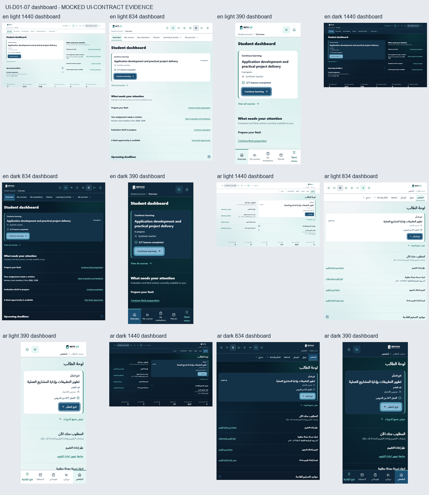
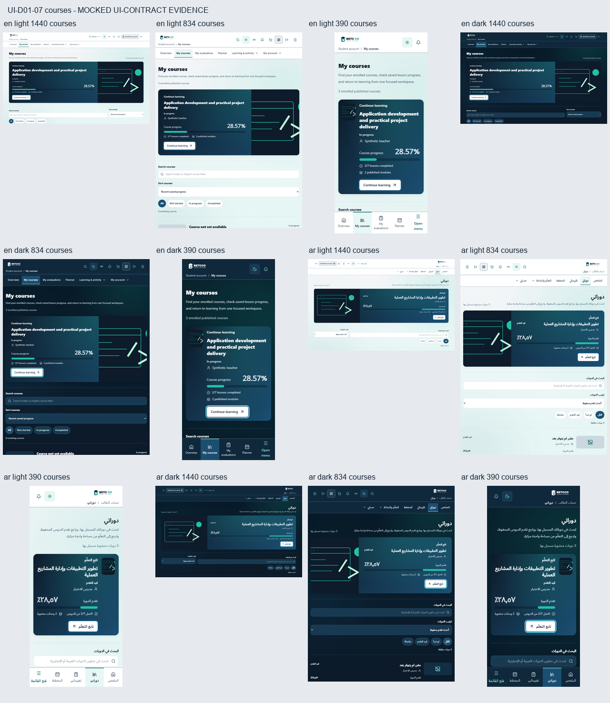
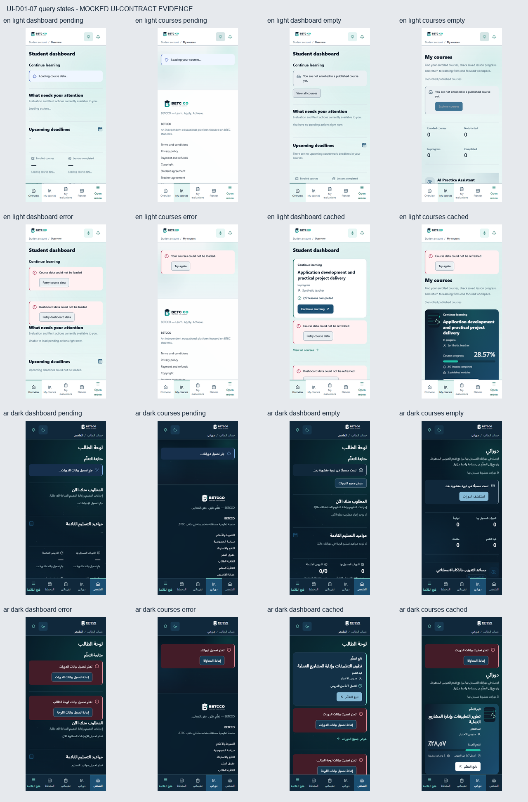

# UI-D01-07 — Student home and course continuity

Base: `4534ec747067e49f90cb77580b13131fa4512469` (merged UI-D01-06, #199).

## Scope and behavior

The dashboard now uses a compact continuation panel with the supplied lesson
completion ratio and existing course action. It does not show a cover or a large
percentage gauge. Current accessible learning, attention, upcoming deadlines,
summary metrics, earned milestones and utilities keep their existing order.
The current course remains the first accessible item in the server's Recent
order, with the existing first-item fallback when all items are unavailable.
The new continuation title uses the locked DC03 routine weight **700**. The
same-PR follow-up changes only that production declaration from 800 to 700;
historical typography elsewhere is retained.

Course catalogue covers become 72px thumbnails on mobile. Featured courses retain
the approved Navy/Teal treatment. A missing or failed cover keeps its existing
fallback. Full and compact hubs now preserve usable React Query data and actions
after a refresh error, alongside the existing factual dashboard refresh copy and
a retry using the existing refetch handle. Cold loading, cold error and successful
empty remain distinct.

Dashboard assignment links retain an optional, URL-encoded `lessonId`. Without it
they keep the course-only URL. The existing catchall forwards the value to the
unchanged player, which sends it through the existing player query. The browser
fixture deliberately supplies an Assignment lesson distinct from the resume
lesson; following the deadline must render the requested Assignment lesson.

## Contract proofs

- The complete `student-area.tsx` reverses to the independently captured base
  hash through exactly two reviewed seams: the dashboard card variant and
  optional deadline lesson link. Missing, duplicate and altered seams fail closed.
- Existing UI-D01-04, role-shell and runtime/i18n proofs keep their original hashes
  and apply only this exact projection. The existing dashboard test now expects
  the approved lesson ratio rather than a percentage gauge.
- Hub API/query calls, keys, options, pagination, search/filter and server sorting
  expressions remain byte-identical to base. The complete hub AI article retains
  its independent base hash. All other Student AI/player code is covered by the
  full Student source proof.
- No dependency, backend, authorization, mutation, upload, payment, entitlement,
  assessment, Resit/Resubmission/Retake or AI/RAG changes. No client ranking,
  overdue count, grade, progress state or milestone is invented.
- Existing translations are reused; neither message catalogue changes.

## Verification

DC03 follow-up validation: **203 focused tests passed in 10 files**, including
the existing bilingual typography contracts and a regression for this selector's
weight. Formatting, ESLint with zero warnings, typecheck, a fresh production build
and diff check passed on the corrected source. Commands:

```powershell
pnpm test tests/student-home-continuity.test.tsx tests/student-continuity-contract.test.ts tests/student-dashboard-pending-actions.test.tsx tests/student-courses-learning-hub.test.tsx tests/student-course-player.test.tsx tests/student-state-contract.test.ts tests/runtime-student-source-audit.test.ts tests/admin-state-contract.test.ts tests/role-navigation-contract.test.ts tests/ui-bilingual-typography.test.tsx --maxWorkers=2
pnpm format:check
pnpm exec eslint . --max-warnings 0
pnpm typecheck
pnpm build
git diff --check
```

Historical full-suite result at reviewed head
`6807de783c1f9217ed5ecb8617692a5ad3e5f5af`: 2729 passed in 111 files. The full
suite was not rerun for this single scoped font-weight correction, in accordance
with the repository's narrow-validation rule; that old run is not claimed as a
new-head test result. The production build and affected browser evidence were
rerun because CSS changed.

## Browser evidence boundary

**MOCKED UI-CONTRACT EVIDENCE.** Actual production Next pages, React Query,
translations, fonts, native links and CSS render against synthetic intercepted
GET responses. The loaded cover is a synthetic SVG served at the unchanged cover
endpoint. This does not establish live backend data, authorization, integration,
assessment correctness, deployment, production readiness or whole-site WCAG.

The browser spec covers both dashboard and courses in EN/AR RTL, Light/Dark,
1440×900, 834×1112 and 390×844; cold pending/error, successful empty and cached
refresh failure; loaded/missing covers; server order and unavailable access;
keyboard reachability/visible focus, reduced-motion progress and horizontal
overflow. The 390px dashboard checks that continuation and the attention heading
remain above the bottom dock. Assignment navigation is verified in both locales.

```powershell
# Run an isolated production server after pnpm build; preserve other local apps.
pnpm start --port 3017
$env:PLAYWRIGHT_PORT='3017'
pnpm exec playwright test tests/e2e/student-home-continuity.spec.ts
# Same-PR DC03 fix: regenerate only the 16 affected dashboard scenarios.
pnpm exec playwright test tests/e2e/student-home-continuity.spec.ts --grep 'dashboard:|dashboard cached:'
```

The existing inline theme initialization can leave `data-theme` unset under the
production CSP. Evidence uses the existing native theme button and asserts the
actual applied theme before capture. Initial theme persistence/bootstrap is
outside this slice and is not claimed fixed.

See the paired viewport overview images and `browser-evidence.json` for the
verified run, screenshot hashes and individual scenarios. Full-size raw captures
are retained in the task output directory documented in that manifest.

Original browser run at reviewed head `6807de7`: 58 passed. The DC03 fix refreshes
only **16 affected captures (16/16 passed, no skipped/flaky cases)**: 12 data views across both locales/themes and three
viewports, plus 4 cached refresh-error views across both locales/themes. The new
run explicitly checks computed continuation title weight 700. The other 42
captures retain their original hashes and provenance; they were not regenerated.
The manifest distinguishes the original run from the refresh and fingerprints
the corrected CSS. It does not present all 58 as a new-head browser run.

Only the dashboard viewport overview and two cached-dashboard panels in the state
overview are refreshed. Every unrelated state panel retains identical pixels;
the course overview remains byte-identical. Overviews crop raw captures to their
initial viewport; full-page originals retain SHA-256 hashes in the manifest.






