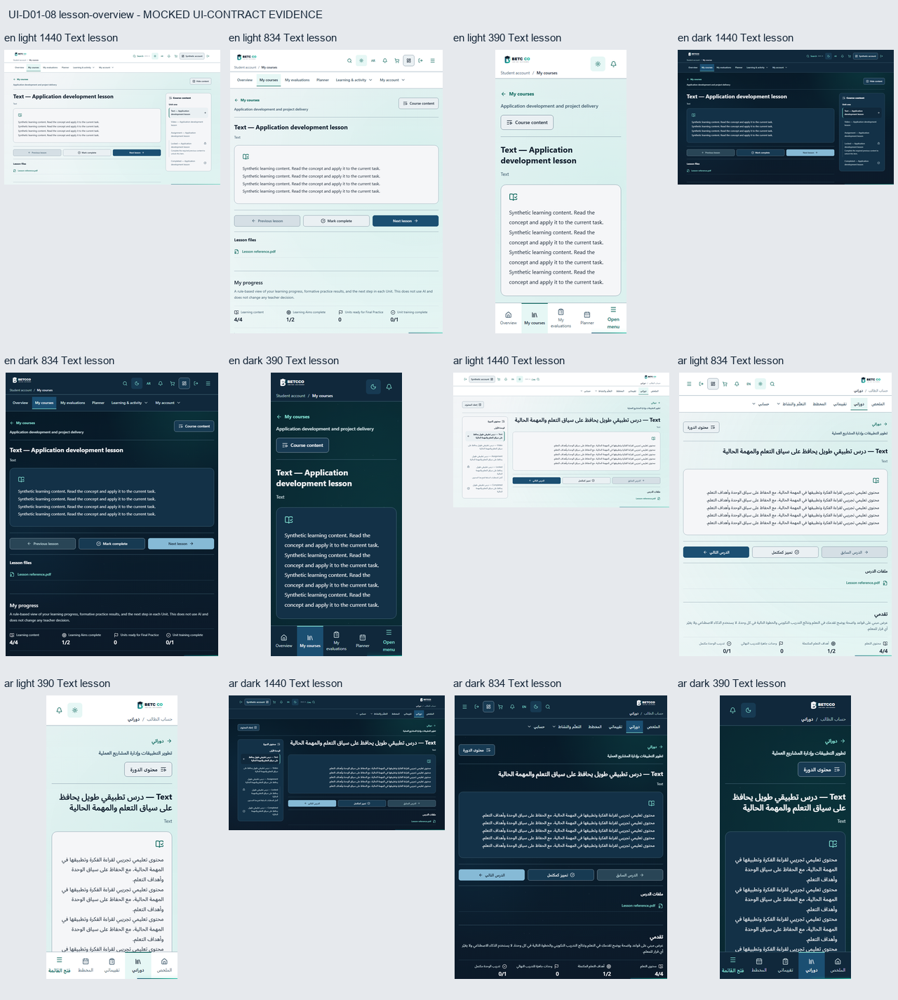
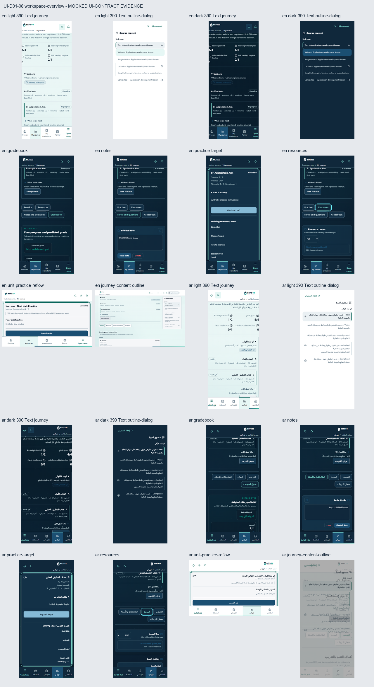
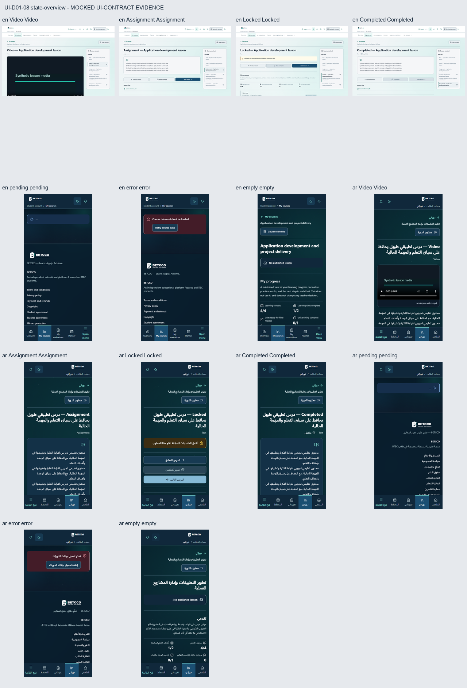

# UI-D01-08 — Make the player a focused learning workspace

Base: `6053c5f3d9d05d2422527da7cdf9d8e754da1c28`, including merged #200.
Exact authoritative roadmap heading: line 114, immediately after UI-D01-07.

## Bounded implementation

The lesson, native media, previous/next links, manual completion guard and outline
remain the primary workspace. Journey keeps its existing saved-data guidance and
adds local **view** actions: configured Aim/Unit practice targets open the Practice
section and receive focus; content guidance opens the current course outline.
No Aim-to-lesson mapping is guessed and no view action starts/submits practice.
Unit rails use existing completion flags and textual state, without percentages
or animation-derived completion.

Practice, Resources (including announcements), Notes/questions and Gradebook use
local accessible tabs. Panels stay mounted with `hidden`, preserving unsaved
comments, selected files, private notes, questions and resource filters. Arrow
keys follow locale direction; Home/End and linked tab/panel semantics are retained.
Programmatic practice navigation focuses the exact existing server Aim/Unit and
waits for its rendered anchor if necessary. The two practice source files receive
only focusable IDs; their queries, eligibility and submission logic are unchanged.

AI remains mounted and visible outside the section switching. Its component,
props, queries/mutations, routes, navigation and integration remain unchanged.
The player/Journey typography uses routine DC03 weights 400/500/600/700. Seven
paired EN/AR navigation leaves are added; every previous translation remains.

## Invariants and source proofs

- Every original Student API/query/mutation/progress/certificate call and the
  entire existing `deriveNextAction` function match independently captured main.
- Exact reviewed presentation seams reverse the complete Student source and the
  two practice anchor changes to their original hashes. Missing, duplicate and
  altered seams fail closed. Historical hashes and T7 audits are retained.
- UI-D01-07 source, lessonId encoding/forwarding, current-course/server ordering,
  pending destinations and cached-data behavior remain protected by regressions.
- No backend, API, authorization, payment/entitlement, assessment, Resit,
  Resubmission, Retake, dependency or AI/RAG change. No state, eligibility, formal
  grade, completion, milestone or lesson mapping is invented.
- Submitted remains distinct from Passed. Content completion, formative training
  outcomes and teacher-assessed/predicted grades remain separate.

## Local verification

- Focused regressions: **170 passed in 9 files**.
- Full frontend suite: **2748 passed in 113 files**.
- Production build, typecheck, ESLint zero warnings, formatting and diff check.

```powershell
pnpm test tests/student-player-contract.test.ts tests/student-player-workspace.test.tsx tests/student-course-player.test.tsx tests/student-progress-intelligence.test.tsx tests/student-home-continuity.test.tsx tests/student-continuity-contract.test.ts tests/student-state-contract.test.ts tests/ui-bilingual-typography.test.tsx tests/learning-practice-source-audit.test.ts --maxWorkers=2
pnpm test --maxWorkers=2
pnpm format:check
pnpm exec eslint . --max-warnings 0
pnpm typecheck
pnpm build
git diff --check
```

## Browser evidence

**MOCKED UI-CONTRACT EVIDENCE.** Actual production Next 16.3.6 player, native
links/media, React Query, fonts, CSS and focus behavior use intercepted synthetic
responses. A small synthetic playable WebM verifies native video play/pause and
position retention. Draft continuation is an intercepted explicit test action;
no live student data or real submission is used. This is not backend integration,
authorization, payment, database, deployment or whole-site WCAG proof.

The scenario manifest pins the current production/catalogue source hashes and all
raw screenshot hashes. **32 scenarios passed, 0 failed/skipped/flaky; 58 new
captures.** Coverage: EN/AR RTL, Light/Dark, 1440×900 / 834×1112 /
390×844; Text/Video/Assignment, locked/completed lessons, pending/cold error/empty,
desktop outline, mobile dialog focus/restoration, long Arabic, expanded Journey,
exact Aim/Final Unit focus, draft/file retention, visible focus, reduced motion
and no horizontal overflow. A 720×450 CSS-pixel viewport is a desktop 200% reflow
proxy; it is not an OS/browser zoom or complete accessibility certification.

```powershell
# Isolated production server after building; keep other user servers running.
pnpm start --port 3019
$env:PLAYWRIGHT_PORT='3019'
pnpm exec playwright test tests/e2e/student-player-workspace.spec.ts
```

The existing production theme initialization may leave `data-theme` unset.
Tests use the existing native toggle and verify the applied theme before capture;
theme initialization/persistence is not modified. Existing embedded practice,
resource, note and gradebook presentation is consumed without starting UI-D01-09
or redesigning their workflows. Cached dashboard/hub regressions are checked;
unchanged player query-error behavior is not claimed redesigned or newly verified
against live backend failures.






